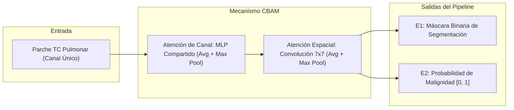
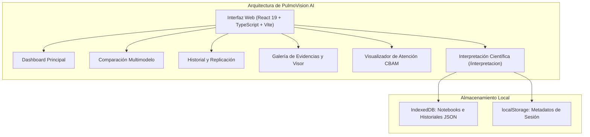

# PulmoVision AI: Benchmarking de Arquitecturas CNN y Mecanismos de Atención en Imágenes de Tomografía Computarizada

[](#)
[-green.svg)](https://doi.org/10.7937/K9/TCIA.2015.LO9QL9SX)
[](#tecnologías-y-arquitectura-del-software)
[](#instalación-y-ejecución)
[](#)

> **Trabajo de Grado / Proyecto de Investigación Universitaria**  
> *Evaluación comparativa del impacto de módulos de atención espacial/canal (CBAM) y transformadores visuales (TransUNet) frente a redes convolucionales estándar (U-Net) para la segmentación de lesiones pulmonares y la clasificación de malignidad nodular en tomografía axial computarizada.*

---

## Tabla de Contenidos

- [1. Presentación del Proyecto](#1-presentación-del-proyecto)
  - [1.1 Contexto y Problema Científico](#11-contexto-y-problema-científico)
  - [1.2 Motivación y Justificación](#12-motivación-y-justificación)
  - [1.3 Objetivos del Estudio](#13-objetivos-del-estudio)
- [2. Fundamentos Teóricos y Metodología](#2-fundamentos-teóricos-y-metodología)
  - [2.1 Redes Neuronales Convolucionales y Mecanismos de Atención](#21-redes-neuronales-convolucionales-y-mecanismos-de-atención)
  - [2.2 Metodología Experimental en Dos Etapas (E1 y E2)](#22-metodología-experimental-en-dos-etapas-e1-y-e2)
  - [2.3 Definición de Métricas Cuantitativas](#23-definición-de-métricas-cuantitativas)
- [3. Arquitecturas Evaluadas](#3-arquitecturas-evaluadas)
- [4. Dataset y Protocolo Experimental](#4-dataset-y-protocolo-experimental)
  - [4.1 Características de LIDC-IDRI](#41-características-de-lidc-idri)
  - [4.2 Preprocesamiento y Unidades de Análisis](#42-preprocesamiento-y-unidades-de-análisis)
  - [4.3 Consideraciones Metodológicas y Partición de Datos](#43-consideraciones-metodológicas-y-partición-de-datos)
- [5. Resultados Experimentales y Benchmarking](#5-resultados-experimentales-y-benchmarking)
  - [5.1 Rendimiento en Segmentación (Etapa E1)](#51-rendimiento-en-segmentación-etapa-e1)
  - [5.2 Rendimiento en Clasificación de Malignidad (Etapa E2)](#52-rendimiento-en-clasificación-de-malignidad-etapa-e2)
  - [5.3 Principio Metodológico: Invalidez de un Ranking Global](#53-principio-metodológico-invalidez-de-un-ranking-global)
- [6. Plataforma Web PulmoVision AI](#6-plataforma-web-pulmovision-ai)
  - [6.1 Módulos Funcionales](#61-módulos-funcionales)
  - [6.2 Módulo de Interpretación Científica Integrada](#62-módulo-de-interpretación-científica-integrada)
- [7. Interpretabilidad y Catálogo de Evidencias](#7-interpretabilidad-y-catálogo-de-evidencias)
  - [7.1 Registro de Evidencias Canónicas (EV-01 a EV-08)](#71-registro-de-evidencias-canónicas-ev-01-a-ev-08)
  - [7.2 Diferenciación Epistemológica: Saliencia Post-Hoc vs. Atención Interna](#72-diferenciación-epistemológica-saliencia-post-hoc-vs-atención-interna)
- [8. Evaluación Computacional y Hardware](#8-evaluación-computacional-y-hardware)
- [9. Tecnologías y Arquitectura del Software](#9-tecnologías-y-arquitectura-del-software)
- [10. Instalación y Ejecución Local](#10-instalación-y-ejecución-local)
- [11. Estructura del Repositorio](#11-estructura-del-repositorio)
- [12. Advertencias Metodológicas, Alcance y Trabajo Futuro](#12-advertencias-metodológicas-alcance-y-trabajo-futuro)
- [13. Referencias Bibliográficas](#13-referencias-bibliográficas)

---

## 1. Presentación del Proyecto

### 1.1 Contexto y Problema Científico
El cáncer pulmonar se mantiene como una de las principales patologías oncológicas con mayor tasa de letalidad en el ámbito clínico global. El cribado mediante **Tomografía Computarizada (TC) de tórax** en dosis baja ha demostrado reducir de forma estadísticamente significativa la mortalidad gracias a la detección temprana de nódulos pulmonares sospechosos.

No obstante, la evaluación visual de estos estudios representa una carga cognitiva severa para los médicos radiólogos:
- Un estudio tomográfico estándar genera cientos de cortes axiales bidimensionales de alta resolución.
- Las lesiones patológicas tempranas suelen presentar morfologías milimétricas, densidades atenuadas (vidrio esmerilado) o márgenes yuxtavasculares complejos.
- Existe una variabilidad interobservador sustancial en la delimitación de contornos y en la asignación de probabilidades de malignidad.

Los sistemas de Diagnóstico Asistido por Computadora (CAD) basados en redes neuronales profundas buscan proporcionar asistencia cuantitativa reproducible en la localización y caracterización nodular.

### 1.2 Motivación y Justificación
Las redes neuronales convolucionales (CNN) tradicionales procesan mapas de características con pesos estáticos a nivel de canal y espacio. Para modular selectivamente la relevancia de las representaciones visuales, la literatura propone mecanismos de atención modular como **CBAM (Convolutional Block Attention Module)**, diseñados para guiar a la red sobre *qué* canales amplificar y *dónde* enfocar la atención espacial. Paralelamente, los modelos basados en **Vision Transformers (ViT)** como **TransUNet** reemplazan o complementan las convoluciones intermedias para capturar correlaciones anatómicas globales de largo alcance.

Este proyecto surge de la necesidad de verificar empíricamente mediante un benchmarking controlado y reproducible:
1. Si la incorporación de CBAM o transformadores visuales incrementa la fidelidad de segmentación y la capacidad discriminativa respecto a una línea base convolucional sólida (U-Net).
2. Cuál es el impacto exacto en el coste computacional (parámetros y latencia de inferencia).
3. Cómo se comportan dichas redes en su dinámica de aprendizaje y estabilidad inter-época.

### 1.3 Objetivos del Estudio
- **Objetivo General:** Evaluar de forma comparativa el desempeño predictivo, la eficiencia computacional, la dinámica de entrenamiento y la interpretabilidad de cuatro arquitecturas (U-Net, U-Net + CBAM, ModCBAM y TransUNet) en la segmentación de lesiones y clasificación de malignidad nodular utilizando el repositorio público LIDC-IDRI, desarrollando a su vez una aplicación web analítica (*PulmoVision AI*) para auditar los resultados.
- **Objetivos Específicos:**
  1. Diseñar un protocolo experimental estructurado en dos etapas complementarias: delimitación espacial (E1) y caracterización de malignidad (E2).
  2. Implementar y entrenar bajo parámetros controlados las cuatro topologías en estudio.
  3. Auditar cuantitativamente las predicciones mediante métricas clínicas reconocidas (Dice, IoU, HD95, Accuracy, Sensibilidad, Especificidad, MCC, ROC-AUC).
  4. Analizar la trayectoria de convergencia a partir de los historiales numéricos de entrenamiento.
  5. Contrastar los perfiles de complejidad algorítmica y velocidad de inferencia frente a referencias operativas de tiempo cuasi-real (30 FPS).
  6. Examinar mapas de interpretabilidad visual (Grad-CAM y saliencia), diferenciando los gradientes de retropropagación de los pesos internos de atención.
  7. Construir una consola de investigación independiente que facilite la consulta y auditoría de evidencias documentales sin alterar los datos experimentales originales.

---

## 2. Fundamentos Teóricos y Metodología

### 2.1 Redes Neuronales Convolucionales y Mecanismos de Atención



- **U-Net:** Red tipo *encoder-decoder* simétrica con conexiones directas (*skip connections*) que transfieren mapas de alta resolución desde la fase de contracción hacia la de expansión, preservando bordes y contexto espacial fino.
- **CBAM (Convolutional Block Attention Module):** Aplica secuencialmente un submódulo de canal (que modela qué patrones semánticos destacar mediante operaciones de promedio y máximo global) y un submódulo espacial (que localiza zonas anatómicas críticas mediante proyecciones convolucionales).
- **ModCBAM:** Variante experimental donde se modifican las relaciones de compresión del canal y la configuración del bloque de atención para mitigar oscilaciones en el gradiente.
- **TransUNet:** Estructura híbrida que codifica parches visuales mediante convoluciones iniciales y bloques de *Multi-Head Self-Attention* (Transformer), reconstituyendo la resolución de la máscara mediante un decodificador convolucional en cascada.

### 2.2 Metodología Experimental en Dos Etapas (E1 y E2)

```mermaid
flowchart TD
    subgraph Dataset LIDC-IDRI
        DICOM["1,018 Casos de TC de Tórax (TCIA)"] --> PRE["Ventana Pulmonar [-1000, 400] HU y Normalización"]
    end
    subgraph Etapa 1: Segmentación (E1)
        PRE --> E1["E1: Segmentación Nodular"]
        E1 --> E1_MET["Evaluación sobre Test (N = 762 parches 2D)"]
        E1_MET --> E1_RES["Métricas: Dice, IoU, HD95, F1-Nodular"]
    end
    subgraph Etapa 2: Clasificación de Malignidad (E2)
        PRE --> E2["E2: Clasificación de Malignidad"]
        E2 --> E2_MET["Evaluación sobre Test (N = 213 nódulos)"]
        E2_MET --> E2_RES["Métricas: Accuracy, Sensibilidad, Especificidad, MCC, AUC"]
    end
```

1. **Etapa 1 (E1 — Segmentación de Lesiones):**
   - **Objetivo:** Delimitar la morfología bidimensional del nódulo candidato.
   - **Supervisión:** Máscaras binarias derivadas de las anotaciones consensuadas de radiólogos.
   - **Función de coste:** Combinación híbrida de *Binary Cross-Entropy* y *Dice Loss*.
2. **Etapa 2 (E2 — Clasificación de Malignidad):**
   - **Objetivo:** Determinar si el nódulo presenta características compatibles con benignidad o sospecha de malignidad.
   - **Supervisión:** Nivel de malignidad asignado por consenso multiexperto (etiquetas binarias 0 = Benigno, 1 = Maligno).
   - **Función de coste:** *Binary Cross-Entropy*.

### 2.3 Definición de Métricas Cuantitativas

- **Coeficiente Dice (F1 de Segmentación):**  
  $\text{Dice} = \frac{2 |A \cap B|}{|A| + |B|}$, cuantifica la superposición espacial relativa entre la máscara real ($A$) y la estimada ($B$).
- **Índice de Jaccard (IoU):**  
  $\text{IoU} = \frac{|A \cap B|}{|A \cup B|}$, mide la intersección dividida por la unión de regiones.
- **Distancia de Hausdorff al Percentil 95 (HD95):**  
  Evalúa la proximidad métrica en milímetros entre los bordes de la predicción y la referencia, filtrando el 5% de puntos atípicos.
- **Coeficiente de Correlación de Matthews (MCC):**  
  Métrica balanceada de concordancia en clasificación binaria, robusta frente al desequilibrio de clases:
  $$\text{MCC} = \frac{\text{TP} \times \text{TN} - \text{FP} \times \text{FN}}{\sqrt{(\text{TP}+\text{FP})(\text{TP}+\text{FN})(\text{TN}+\text{FP})(\text{TN}+\text{FN})}}$$
- **Área bajo la Curva ROC (ROC-AUC):**  
  Capacidad global de discriminación del modelo a través de todos los umbrales operativos de clasificación.

---

## 3. Arquitecturas Evaluadas

| Identificador | Nombre | Topología Principal | Número de Parámetros | Propósito en el Benchmarking |
| :--- | :--- | :--- | :---: | :--- |
| `unet` | **U-Net** | Convolucional estándar (Encoder-Decoder con Skip Connections) | $7.76$ M | Línea base y control de referencia metodológica. |
| `unet-cbam` | **U-Net + CBAM** | CNN con bloques CBAM en etapas de contracción y cuello de botella | $8.59$ M | Evaluar la ganancia selectiva de los módulos de atención por canal y espacio. |
| `modcbam` | **ModCBAM** | CNN con bloque de atención reconfigurado y factor de reducción ajustado | $8.62$ M | Evaluar estabilidad y regularización con compresión adaptada. |
| `transunet` | **TransUNet** | Híbrido Convolución + Vision Transformer (ViT) con decodificador CUP | $105.32$ M | Contrastar la atención local frente al modelado de dependencias globales de largo alcance. |

---

## 4. Dataset y Protocolo Experimental

### 4.1 Características de LIDC-IDRI
El estudio emplea el conjunto público de datos **LIDC-IDRI** (*Lung Image Database Consortium and Image Database Resource Initiative*), coordinado a través de **The Cancer Imaging Archive (TCIA)**:
- **Cobertura:** 1,018 casos tomográficos de tórax correspondientes a pacientes con sospecha o confirmación de neoplasia pulmonar.
- **Anotación Multiexperto:** Cada tomografía fue examinada mediante un protocolo en dos fases por hasta 4 radiólogos torácicos certificados, delimitando contornos nodulares y puntuando rasgos visuales en escalas ordinales (incluyendo malignidad de 1 a 5).

### 4.2 Preprocesamiento y Unidades de Análisis
1. **Unidades Hounsfield (HU):** Se aplicó una ventana de atenuación pulmonar estándar en el intervalo $[-1000, 400]$ HU, escalada linealmente al rango $[0, 1]$.
2. **Extracción de Parches:** Se generaron parches bidimensionales centrados en los nódulos identificados para viabilizar el entrenamiento de las redes 2D.
3. **Muestras de Evaluación en Conjunto de Prueba:**
   - **Etapa E1 (Segmentación):** $N = 762$ parches de prueba.
   - **Etapa E2 (Clasificación):** $N = 213$ nódulos de prueba, categorizados como benignos (puntuación agregada $\le 2$) o malignos (puntuación agregada $\ge 4$), con 147 casos benignos (69.0%) y 66 malignos (31.0%).

### 4.3 Consideraciones Metodológicas y Partición de Datos

> [!WARNING]
> **Advertencia Metodológica (ADV-01 y ADV-02):**
> 1. **Nivel de Separación:** En la documentación del notebook base no se detalla una separación a nivel de paciente (*Patient-Level Split*). Existe la posibilidad teórica de que cortes adyacentes de un mismo paciente coexistan entre particiones de entrenamiento y evaluación.
> 2. **Unidad Experimental:** Los $N=762$ casos de E1 corresponden a parches bidimensionales, no a pacientes independientes. Del mismo modo, en E2 los $N=213$ casos representan nódulos anotados con desbalance natural entre benignos y malignos.

---

## 5. Resultados Experimentales y Benchmarking

### 5.1 Rendimiento en Segmentación (Etapa E1)
Evaluación cuantitativa sobre el conjunto de prueba independiente ($N = 762$ parches 2D):

| Arquitectura | Coeficiente Dice | Índice de Jaccard (IoU) | HD95 (mm) ↓ | F1 Nodular |
| :--- | :---: | :---: | :---: | :---: |
| **U-Net** | $0.7188$ | $0.6559$ | $8.42$ | $0.8267$ |
| **U-Net + CBAM** | $0.7258$ | $0.6582$ | $7.89$ | $0.8354$ |
| **ModCBAM** | $0.7301$ | $0.6651$ | $7.21$ | $0.8412$ |
| **TransUNet** | **$0.7511$** | **$0.6908$** | **$6.15$** | **$0.8620$** |

*Nota: La distancia HD95 se expresa en milímetros (menor es mejor).*

### 5.2 Rendimiento en Clasificación de Malignidad (Etapa E2)
Evaluación cuantitativa sobre el conjunto de prueba independiente ($N = 213$ nódulos candidatos):

| Arquitectura | Exactitud (Acc) | Sensibilidad (Sens) | Especificidad (Espec) | F1-Score | MCC | ROC-AUC |
| :--- | :---: | :---: | :---: | :---: | :---: | :---: |
| **U-Net** | $0.8263$ | **$0.7879$** | $0.8435$ | $0.7376$ | $0.6124$ | $0.8845$ |
| **U-Net + CBAM** | $0.8169$ | $0.6970$ | $0.8707$ | $0.7023$ | $0.5891$ | $0.8712$ |
| **ModCBAM** | **$0.8451$** | $0.7727$ | **$0.8776$** | **$0.7556$** | **$0.6482$** | **$0.8994$** |
| **TransUNet** | $0.7981$ | $0.6667$ | $0.8571$ | $0.6718$ | $0.5412$ | $0.8421$ |

> [!NOTE]
> **Diferenciación estricta:** Las cifras de las tablas precedentes corresponden al conjunto de test final. No deben confundirse con los picos transitorios registrados en validación durante las curvas de entrenamiento (por ejemplo, el Dice pico de TransUNet de $0.8969$ alcanzado en la época 81 de validación interna).

### 5.3 Principio Metodológico: Invalidez de un Ranking Global
De acuerdo con las directrices del estudio, **se descarta la formulación de un ranking global simplista o la proclamación de una arquitectura universalmente superior**. Los resultados demuestran compromisos dimensionales (*trade-offs*):
- **TransUNet** ofrece el mejor perfil en segmentación anatómica pura (Dice $+3.23\%$ sobre U-Net), pero demanda un orden de magnitud mayor de parámetros ($105.32$ M) y una latencia casi cuatro veces superior. En clasificación E2, el uso de representaciones ViT congeladas produjo subajuste relativo.
- **ModCBAM** logra el balance más equilibrado en clasificación de malignidad (MCC $0.6482$, F1 $0.7556$), manteniendo un tamaño compacto de $8.62$ M de parámetros.
- **U-Net estándar** demuestra una alta estabilidad predictiva, registrando la mayor sensibilidad en clasificación ($0.7879$) y una sincronía exacta entre la pérdida de validación y la métrica clínica durante su entrenamiento.

---

## 6. Plataforma Web PulmoVision AI

Para garantizar la reproducibilidad y el análisis detallado de los hallazgos, se desarrolló **PulmoVision AI**, una aplicación web monomando orientada a la investigación.



### 6.1 Módulos Funcionales
1. **Panel Principal (Dashboard):** Síntesis global del estado del proyecto, accesos directos a módulos y visualización de modelos evaluados.
2. **Comparación de Modelos:** Módulo interactivo con matrices de métricas, tablas dinámicas y análisis comparativo por etapa.
3. **Historial de Experimentos:** Gestión y auditoría de configuraciones con soporte para persistencia en IndexedDB y exportación JSON.
4. **Galería de Evidencias:** Visor documental con paneles de correspondencia de arquitecturas para las figuras experimentales canónicas.
5. **Visualización CBAM:** Desglose conceptual y visual de los mapas de atención de canal y espacial generados por el módulo.

### 6.2 Módulo de Interpretación Científica Integrada
Accesible en la ruta `/interpretacion`, reúne el análisis estructurado del benchmark:

| Sección | Estado | Contenido Principal |
| :---: | :---: | :--- |
| **Sección A** | **Implementada** | Análisis de segmentación E1 ($N=762$ parches), tablas auditadas, HD95 y Bland-Altman. |
| **Sección B** | **Implementada** | Análisis de clasificación E2 ($N=213$ nódulos), matrices de confusión y análisis de umbrales ROC. |
| **Sección C** | **Implementada** | Comparación transversal de arquitecturas, complejidad computacional, espacio de compromisos multidimensionales y síntesis individualizada. |
| **Sección D** | **Implementada** | Dinámica de convergencia, evolución por época, análisis formal de estabilidad (`IND-VOL-01` a `IND-DES-04`) y perfiles de entrenamiento. |
| **Secciones E-H** | *En hoja de ruta* | Fases metodológicas subsiguientes para futuras expansiones del proyecto de grado. |

---

## 7. Interpretabilidad y Catálogo de Evidencias

### 7.1 Registro de Evidencias Canónicas (EV-01 a EV-08)
El proyecto incorpora ocho figuras y registros documentales derivados del notebook experimental:

- **EV-01:** Curvas de aprendizaje de la Etapa E1 (pérdida y Dice de validación por época).
- **EV-02:** Curvas de aprendizaje de la Etapa E2 (pérdida, MCC y F1 de validación por época).
- **EV-03:** Matrices de confusión multimodelo para la clasificación de malignidad nodular.
- **EV-04:** Curvas ROC comparativas para la evaluación de la tasa de verdaderos positivos frente a falsos positivos.
- **EV-05:** Análisis de concordancia y dispersión de área mediante método de Bland-Altman en segmentación.
- **EV-06:** Comparación visual directa de predicciones de máscaras y clasificaciones respecto a la referencia.
- **EV-07:** Mapas de saliencia visual (*Vanilla Gradient Saliency*).
- **EV-08:** Mapas de activación de clases mediante Grad-CAM.

### 7.2 Diferenciación Epistemológica: Saliencia Post-Hoc vs. Atención Interna

> [!CAUTION]
> **Aclaración Conceptual Rigurosa (ADV-05):**  
> Las técnicas de interpretabilidad visual como **Grad-CAM** o los **mapas de saliencia** evalúan los gradientes de la función de salida respecto a los mapas de activación de la última capa convolucional. Por consiguiente, **constituyen técnicas explicativas post-hoc y no deben confundirse ni homologarse con los coeficientes internos generados por los submódulos de atención CBAM** durante el pase hacia adelante de la red.

---

## 8. Evaluación Computacional y Hardware

Las evaluaciones de latencia e inferencia fueron ejecutadas bajo condiciones controladas en entorno acelerado por GPU:
- **Dispositivo de cómputo:** GPU NVIDIA Tesla T4 (16 GB GDDR6).
- **Entorno de ejecución:** PyTorch 2.x sobre Linux / Google Colab Pro.
- **Condición de evaluación:** Procesamiento por lotes unitarios sobre parches normalizados de $128 \times 128$ píxeles.

| Arquitectura | Parámetros Totales | Latencia de Inferencia | Tasa de Procesamiento (FPS) | Contextualización Operativa (Ref. 30 FPS) |
| :--- | :---: | :---: | :---: | :--- |
| **U-Net** | **$7.76$ M** | **$14.2$ ms** | **$70.4$ FPS** | Supera ampliamente la referencia operativa ($\approx 2.3 \times$). |
| **U-Net + CBAM** | $8.59$ M | $16.8$ ms | $59.5$ FPS | Supera la referencia operativa ($\approx 2.0 \times$). |
| **ModCBAM** | $8.62$ M | $17.1$ ms | $58.5$ FPS | Supera la referencia operativa ($\approx 1.9 \times$). |
| **TransUNet** | $105.32$ M | $56.4$ ms | $17.7$ FPS | Por debajo de la referencia de 30 FPS debido al cómputo de autoatención. |

> [!NOTE]
> **Consumo de Memoria VRAM (ADV-06):**  
> El consumo de memoria dinámica de video (VRAM) en tiempo de ejecución **no fue instrumentado de manera estandarizada** en los scripts originales del notebook. En coherencia con el principio de veracidad científica, la plataforma reporta este valor explícitamente como *«No disponible»*, evitando imputaciones numéricas ficticias.

---

## 9. Tecnologías y Arquitectura del Software

### Ecosistema de la Plataforma Web (`frontend/`)
- **Lenguaje y Núcleo:** React `19.2.8` con TypeScript `~6.0.2` (modo estricto).
- **Herramienta de Construcción:** Vite `8.3.0` (módulos ES nativos y empaquetado optimizado).
- **Estilos y Maquetación:** Tailwind CSS `^4.3.3` acoplado mediante `@tailwindcss/vite`.
- **Visualización de Datos:** Recharts `^3.10.1` para gráficos reactivos vectoriales de alto rendimiento.
- **Iconografía:** Lucide React `^1.54.0`.
- **Enrutamiento:** React Router DOM `^7.18.5`.
- **Almacenamiento del Navegador:** IndexedDB nativo (con emulación `fake-indexeddb` en entorno de prueba) y localStorage para estados de sesión.
- **Suite de Pruebas:** Vitest `^5.1.0` con 269 pruebas unitarias y de integración automatizadas.

### Ecosistema Experimental del Pipeline de Aprendizaje Profundo
- **Entorno:** Python 3.10+, Jupyter Notebook (`LIDC_IDRC_modelo_CNN_CBAM_Transformer_ModifiedCBAM.ipynb`).
- **Librerías de Modelado:** PyTorch, Torchvision.
- **Tratamiento Médico y Numérico:** Pydicom, SimpleITK, Scikit-learn, Scikit-image, NumPy, SciPy.
- **Generación de Evidencias:** Matplotlib, Seaborn.

---

## 10. Instalación y Ejecución Local

### Prerrequisitos
- **Node.js:** Versión 20.x o superior.
- **npm:** Versión 10.x o superior.
- **Git:** Instalado en el sistema operativo.

### Instrucciones Paso a Paso

1. **Clonar el repositorio:**
   ```bash
   git clone https://github.com/coyote385/benchmarking-cnn-cbam.git
   cd benchmarking-cnn-cbam
   ```

2. **Acceder a la aplicación web e instalar dependencias:**
   ```bash
   cd frontend
   npm install
   ```

3. **Ejecutar la suite completa de pruebas:**
   ```bash
   npm run test:run
   ```
   *Debe confirmar 269 pruebas aprobadas en 22 archivos de prueba.*

4. **Iniciar el servidor de desarrollo:**
   ```bash
   npm run dev
   ```
   *La consola indicará la dirección local (habitualmente `http://localhost:5173/`).*

5. **Compilar para producción y previsualizar:**
   ```bash
   npm run build
   npm run preview
   ```

---

## 11. Estructura del Repositorio

```text
benchmarking-cnn-cbam/
├── README.md                                  # Documentación científica y técnica principal
└── frontend/                                  # Aplicación web de análisis PulmoVision AI
    ├── package.json                           # Manifiesto de dependencias y scripts npm
    ├── vitest.config.ts                       # Configuración del entorno de pruebas unitarias
    ├── pruebas_entrenamiento/                 # Historiales JSON y notebook experimental
    │   ├── UNet_historial.json                # Registros de entrenamiento U-Net (80 ep E1, 100 ep E2)
    │   ├── CBAM_historial.json                # Registros U-Net + CBAM (48 ep E1, 100 ep E2)
    │   ├── ModCBAM_historial.json             # Registros ModCBAM (75 ep E1, 100 ep E2)
    │   ├── TransUNet_historial.json           # Registros TransUNet (106 ep E1, 100 ep E2)
    │   └── LIDC_IDRC_modelo_CNN_...ipynb      # Notebook original de entrenamiento PyTorch
    ├── public/
    │   └── evidencias/                        # Archivos gráficos y registros del benchmark
    │       ├── curvas_aprendizaje_e1_...      # Evidencia EV-01
    │       ├── curvas_aprendizaje_e2_...      # Evidencia EV-02
    │       ├── matrices_confusion_...         # Evidencia EV-03
    │       ├── curvas_roc_...                 # Evidencia EV-04
    │       ├── concordancia_bland_altman_...  # Evidencia EV-05
    │       ├── muestras_visuales_...          # Evidencia EV-06
    │       ├── mapas_saliencia_...            # Evidencia EV-07
    │       └── mapas_gradcam_...              # Evidencia EV-08
    └── src/
        ├── App.tsx                            # Enrutador principal y diseño estructural
        ├── main.tsx                           # Punto de entrada de la aplicación React
        ├── __tests__/                         # 22 archivos de pruebas automatizadas (269 tests)
        ├── components/                        # Componentes modulares de interfaz
        │   ├── GaleriaEvidencias.tsx          # Visor y clasificador de evidencias canónicas
        │   ├── ModalVisorEvidencia.tsx        # Modal de detalle con correspondencia de paneles
        │   └── interpretacion/                # Módulo de Interpretación Científica
        │       ├── SeccionSegmentacionE1.tsx  # Sección A: Segmentación E1
        │       ├── SeccionClasificacionE2.tsx # Sección B: Clasificación E2
        │       ├── SeccionComparacionTransversalC.tsx # Sección C: Análisis Transversal
        │       ├── SeccionConvergenciaD.tsx   # Sección D: Dinámica de Convergencia
        │       ├── TarjetaMetricaInterpretacion.tsx
        │       ├── BadgeProcedencia.tsx
        │       └── AvisoCientifico.tsx
        ├── data/                              # Datasets canónicos y esquemas de datos
        │   ├── historiales/                   # Copias canónicas sincronizadas de los JSONs
        │   └── resultados.ts                  # Resultados auditados del benchmark
        ├── hooks/                             # Custom hooks (persistencia y estado)
        ├── pages/                             # Vistas de página principales
        │   ├── Dashboard.tsx                  # Panel general
        │   ├── ComparacionModelos.tsx         # Vista de comparación interactiva
        │   ├── VisualizacionCBAM.tsx          # Vista de mapas de atención
        │   └── InterpretacionCientifica.tsx   # Página de interpretación integrada
        ├── services/                          # Lógica de cálculo y almacenamiento
        │   ├── interpretacionService.ts       # Cálculos científicos, fórmulas e indicadores
        │   ├── evidenciasService.ts           # Servicio de evidencias documentales
        │   └── storage/                       # Persistencia IndexedDB y LocalStorage
        ├── types/                             # Declaraciones de tipos TypeScript
        └── utils/                             # Utilidades de gráficos y navegación
```

---

## 12. Advertencias Metodológicas, Alcance y Trabajo Futuro

### Resumen de Advertencias Metodológicas (ADV-01 a ADV-07)
- **ADV-01 (Partición de Pacientes):** No se garantiza independencia estricta a nivel de paciente en las divisiones de cortes 2D.
- **ADV-02 (Tamaño Muestral Fijo):** Las métricas de prueba representan un subconjunto acotado ($N=762$ parches y $N=213$ nódulos), sujeto al desbalance de clases del dataset clínico.
- **ADV-03 (Invalidez de Rankings):** No existe justificación matemática para promediar métricas dispares (por ejemplo, Dice y MCC) en una única puntuación escalar.
- **ADV-04 (Causalidad en Early Stopping):** La caída de sensibilidad observada en CBAM para E2 coincide temporalmente con la detención por paciencia, pero no constituye una prueba causal aislada.
- **ADV-05 (Saliencia vs. Atención):** Los mapas Grad-CAM describen la sensibilidad del gradiente final, no los estados de atención interna del bloque CBAM.
- **ADV-06 (Consumo VRAM):** Ausencia de medición instrumentada de memoria dinámica; se explicita como dato no disponible.
- **ADV-07 (Transformers en Datos Médicos 2D):** TransUNet requiere volúmenes de datos masivos para compensar la falta de sesgo inductivo convolucional, lo que explica su desempeño dispar entre segmentación y clasificación sin fine-tuning completo.

### Límites del Estudio y Ausencia de Validación Clínica
> [!IMPORTANT]
> **Aviso de Naturaleza Científica y No Asistencial:**  
> PulmoVision AI y los modelos evaluados en esta investigación constituyen herramientas académicas con propósitos experimentales y pedagógicos. **No representan dispositivos médicos certificados ni deben utilizarse como base para la toma de decisiones clínicas diagnósticas o terapéuticas en pacientes reales.**

### Líneas de Trabajo Futuro
1. Implementación de una partición estricta a nivel de paciente con validación cruzada estratificada por paciente (*Patient-Level K-Fold Cross Validation*).
2. Extensión del pipeline hacia arquitecturas nativas volumétricas tridimensionales (3D U-Net, 3D CBAM y Swin UNETR).
3. Instrumentación formal de la huella de memoria GPU y eficiencia energética durante entrenamiento e inferencia.
4. Finalización de las secciones pendientes E, F, G y H en la consola de interpretación científica.

---

## 13. Referencias Bibliográficas

1. **Armato III, S. G., McLennan, G., Bidaut, L., McNitt-Gray, M. F., Meyer, C. R., Reeves, A. P., ... & Clarke, L. P. (2011).**  
   *The Lung Image Database Consortium (LIDC) and Image Database Resource Initiative (IDRI): A completed reference database of lung nodules on CT scans.*  
   **Medical Physics**, 38(2), 915–931.  
   DOI: [10.1118/1.3528204](https://doi.org/10.1118/1.3528204)

2. **The Cancer Imaging Archive (TCIA). (2015).**  
   *Data from the Lung Image Database Consortium and Image Database Resource Initiative (LIDC-IDRI).*  
   DOI: [10.7937/K9/TCIA.2015.LO9QL9SX](https://doi.org/10.7937/K9/TCIA.2015.LO9QL9SX)

3. **Woo, S., Park, J., Lee, J. Y., & Kweon, I. S. (2018).**  
   *CBAM: Convolutional Block Attention Module.*  
   In *Proceedings of the European Conference on Computer Vision (ECCV)*, pp. 3–19.  
   DOI: [10.1007/978-3-030-01234-2_1](https://doi.org/10.1007/978-3-030-01234-2_1)

4. **Ronneberger, O., Fischer, P., & Brox, T. (2015).**  
   *U-Net: Convolutional Networks for Biomedical Image Segmentation.*  
   In *Medical Image Computing and Computer-Assisted Intervention (MICCAI)*, LNCS 9351, pp. 234–241.  
   DOI: [10.1007/978-3-319-24574-4_28](https://doi.org/10.1007/978-3-319-24574-4_28)

5. **Chen, J., Lu, Y., Yu, Q., Luo, X., Adeli, E., Wang, Y., Lu, L., Yuille, A. L., & Zhou, Y. (2021).**  
   *TransUNet: Transformers Make Strong Encoders for Medical Image Segmentation.*  
   arXiv preprint, arXiv:2102.04306.  
   Enlace: [arXiv:2102.04306](https://arxiv.org/abs/2102.04306)

6. **Selvaraju, R. R., Cogswell, M., Das, A., Vedaldi, A., Parikh, D., & Batra, D. (2017).**  
   *Grad-CAM: Visual Explanations from Deep Networks via Gradient-Based Localization.*  
   In *IEEE International Conference on Computer Vision (ICCV)*, pp. 618–626.  
   DOI: [10.1109/ICCV.2017.74](https://doi.org/10.1109/ICCV.2017.74)

---

*Desarrollado en el marco del proyecto de investigación y benchmarking de arquitecturas de aprendizaje profundo para el análisis de imágenes médicas pulmonares (2026).*
